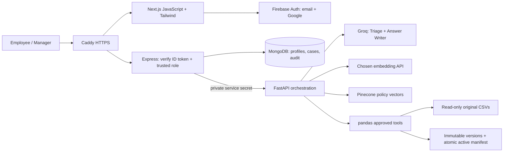

# Punjab Sports Mart · Retail Operations Copilot

A JavaScript Next.js workspace, Express/Mongoose application API, and private FastAPI/pandas AI/data service, implemented around the actual supplied Use Case 3 files. It recommends actions and persists internal cases; it does not execute refunds, claims, transfers, payments, or notifications in outside systems.

**Start with `docs/VERIFICATION.md` for observed checks and limitations.** Source schemas and policy decisions are in `docs/SOURCE_NOTES.md`. Live Firebase, Groq, embedding and Pinecone credentials were not supplied. Missing AI configuration is displayed as unavailable, never substituted with demo AI results.

## Architecture



Request flow: authenticate → validate/mask → safety gate → LLM triage → approved CSV functions → Pinecone retrieval → deterministic escalation → LLM excerpt selection → exact citation validation/masking → Mongo case persistence. A security refusal is deterministic and works without model credentials. Operational analysis unavailable from a provider is explicitly marked and routed for human review. Context for follow-ups is loaded from authorized saved cases and masked again.

```text
web/                    Next.js App Router JS/JSX, Firebase client, responsive UI
api/src/                Express routes, Firebase Admin, Mongoose, manager bootstrap
api/test/               Auth unit tests + real Mongo/Python integration tests
ai-service/app/          Providers, policies, workflow, safety, datasets, analytics, evaluation
ai-service/tests/        Source, CSV versioning, analytics, safety and contract tests
data/*.csv               Original supplied data, unchanged
knowledge_base/*.md      Original supplied policy text, unchanged
evaluation/*.csv         Original public cases and prediction schema, unchanged
data/uploads/            Generated immutable staged CSVs and active manifest (ignored)
data/generated/          Evaluation outputs and index metadata (ignored)
docs/                    Source hashes/profile, rule decisions, verification
deploy/                  Caddy TLS/reverse proxy and Mongo initialization
scripts/                 Source integrity and deterministic analytics report
docker-compose.yml       Caddy, Next.js, Express, FastAPI, MongoDB
```

## Local setup

Prerequisites: Node 22.14+ (Node 22 recommended), Python 3.13, MongoDB 8 or a managed MongoDB endpoint, Firebase project, Groq account, chosen embeddings API, and Pinecone project. Docker Engine + Compose are required only for container deployment. Tests can download an isolated MongoDB binary; on Windows that first download is large (~755 MB), cached under `work/mongodb`.

Run from the project root in PowerShell:

```powershell
Copy-Item .env.example .env
python -m venv work\venv
work\venv\Scripts\python -m pip install -r ai-service\requirements.lock.txt
cd api
npm ci
cd ..\web
npm ci
cd ..
```

Populate `.env`, then copy **only** the public client values into `web/.env.local`:

```text
NEXT_PUBLIC_API_URL=http://localhost:4000/api/v1
NEXT_PUBLIC_FIREBASE_API_KEY=your-public-web-key
NEXT_PUBLIC_FIREBASE_AUTH_DOMAIN=your-project.firebaseapp.com
NEXT_PUBLIC_FIREBASE_PROJECT_ID=your-project
NEXT_PUBLIC_FIREBASE_APP_ID=your-web-app-id
```

Those values are compiled into the browser bundle. Rebuild after changing them. Do not copy server credentials to the web directory. Python and Express read the root `.env`. Python source/data defaults are computed from the repo root, not the shell's working directory. Linux equivalents use `python3 -m venv work/venv` and `work/venv/bin/python`.

In three terminals:

```powershell
# Terminal 1, from ai-service/
..\work\venv\Scripts\python -m uvicorn app.main:app --host 127.0.0.1 --port 8000 --no-access-log
# Terminal 2, from api/
npm start
# Terminal 3, from web/
npm run dev
```

Open `http://localhost:3000`. `/health` is liveness; Express `/ready` checks Mongo, Python and source availability. Authenticated `/api/v1/services` reports missing AI settings; readiness does not claim external providers are live. Express refuses startup without required configuration and retries initial Mongo connection ten times. The Python process remains available for policy/data operations when AI keys are missing.

## Firebase and roles

1. Create/select your own Firebase project and add a web app. In Firebase Console → Authentication → Sign-in method, enable **Email/Password** and **Google**. Select the required Google support email.
2. Add `localhost` and your production hostname in Authentication → Settings → Authorized domains (host only, no scheme or port).
3. Copy the Firebase web config into the public variables above.
4. Supply a Firebase Admin service account through an absolute `GOOGLE_APPLICATION_CREDENTIALS` path or Application Default Credentials; set `GOOGLE_CLOUD_PROJECT`. Keep the file outside Git or in ignored `secrets/` with restricted filesystem permissions. The backend uses `verifyIdToken(token, true)`, including revoked-token checking.
5. Register normally. The server creates an Employee profile regardless of client fields or source employee persona. The browser has no role-selection endpoint.
6. An administrator with trusted shell/DB/service-account access can assign the first Manager after verifying the intended user's Firebase UID:

```powershell
# api/; UID is the existing user in Firebase Authentication
npm run bootstrap-manager -- FIREBASE_UID
```

The CLI verifies the Firebase user exists, updates the trusted Mongo profile, and writes an audit event. No bootstrap HTTP endpoint exists. For revocation, use trusted administration to change the profile role and revoke Firebase refresh tokens; role is read from Mongo on each API call. No production auth bypass exists. Test code injects an identity verifier only inside the test process and is not used by `server.js`; production refuses emulator/bypass environment settings.

Employees: own cases, new incidents, policies, non-PII CSV analytics. Managers: all application cases, case status updates, CSV stage/history/activation/rollback. Store IDs in source files do not grant access. Source employee records are not an authentication directory.

## Groq, embeddings, and Pinecone

Set `GROQ_API_KEY` and replace the **non-working** `GROQ_MODEL=REPLACE_WITH_SUPPORTED_GROQ_LLAMA_3_3_MODEL_ID` with the exact supported Llama 3.3 model ID in your account. The app uses the [documented Groq chat API](https://console.groq.com/docs/api-reference), JSON object mode plus Pydantic validation, bounded output, timeout, and bounded transient retry. It does not hard-code a live model name.

No embedding provider/model has been selected for you. Choose an API supporting `POST {base}/embeddings` with `{model,input:[strings]}` and response `{data:[{index,embedding:[numbers]}]}`. Set `EMBEDDING_PROVIDER=openai-compatible`, immutable/versioned `EMBEDDING_MODEL`, HTTPS `EMBEDDING_BASE_URL` (usually ending in `/v1`), and `EMBEDDING_API_KEY`. The same config/preprocessing signature is required for ingestion/query. Hosted embeddings add API cost/network dependency and transmit policy chunks/masked queries to that chosen provider. There is no local sentence-transformers adapter in this implementation.

Set `PINECONE_API_KEY`, `PINECONE_INDEX`, and, for creation, `PINECONE_CLOUD`, `PINECONE_REGION`, `PINECONE_METRIC`. The explicit operator command below requests a vector index with a dimension measured from a real embedding response using the [Pinecone REST API](https://docs.pinecone.io/reference/api/2025-10/control-plane/describe_index). It can incur provider costs when configured; run it once if the index does not exist. Do not call it again merely because an index is still becoming ready.

```powershell
# ai-service/
..\work\venv\Scripts\python -m app.create_index
..\work\venv\Scripts\python -m app.ingest
```

Existing index: run ingestion directly. The dimension is checked against the measured vector size and optional `PINECONE_DIMENSION`; mismatches fail without truncation/padding. Ingestion creates stable chunk IDs and a corpus/config namespace, upserts in batches, waits for the namespace vector count, then atomically writes `data/generated/index-manifest.json`. Re-run ingestion safely after failures or policy changes. Prior namespaces are retained but never queried as active after a successful switch. Do not delete old namespaces until the current signature and backups are verified. Changing models/dimensions usually requires a new index; never delete a working index to fix a config typo.

`RETRIEVAL_TOP_K` defaults to 6. `RETRIEVAL_MIN_SCORE` is unset: thresholds depend on the selected embeddings and metric and require evaluation. Returned IDs are resolved against local original chunks, so a provider cannot introduce a fictitious filename. Exact excerpts reduce unsupported claims but do not prove semantic relevance. Human review remains necessary.

## CSV Data Update

As a Manager, open **CSV Data Update**. Select one of the nine inspected datasets, drag/drop or choose UTF-8 CSV, then **Validate & preview**. Review row counts, schema, safe sample rows, errors and checksum/version metadata. Only a valid staged upload enables explicit confirmation. Failed versions remain recorded and cannot activate.

The validator enforces comma delimiter, header order, required/nullable cells, dates, integer/rate types, original category vocabularies, unique primary keys, references, 5 MiB/file and 50,000 rows by default. Formula-like cells are plain text; exported evaluation CSV values are escaped. Employee names are withheld from previews. Stored versions use generated UUID paths, not uploaded filenames.

Activation revalidates the bytes/checksum and all prospective dataset relationships under a cross-process file lock, checks the caller's expected manifest revision, and atomically replaces one manifest. Every analytical request reads one snapshot; no partial CSV is active. Staging, uploads, and prior originals are never overwritten. **Roll back** points to a valid previous version (or original). A stale revision requires refreshing before retrying. No automatic deletion is performed; storage quota defaults to 1 GiB. Back up the version directory and its manifest together.

The manifest's events are the authoritative activation/rollback audit committed with the pointer. Mongo stores upload metadata and requested mutation audit events. A crash between filesystem and Mongo operations may require reconciling metadata; the immutable filesystem history remains intact. There is no distributed transaction across Mongo and filesystem. Do not run replicas with separate volume copies: use one shared local filesystem, one AI service replica, and the provided file lock. No cache of CSV analytics persists across activation.

Policy and role governance always use trusted original policy/matrix and Mongo roles, even if a manager stages revised employee/escalation CSVs. This application never updates a live POS/ERP system.

## Tests, build, integrity and evaluation

```powershell
# project root
python scripts\inspect_sources.py
work\venv\Scripts\python scripts\analytics_report.py
# ai-service/
..\work\venv\Scripts\python -m pytest -q
..\work\venv\Scripts\python -m app.evaluate
# api/
npm run check
npm test
npm audit --omit=dev
# web/
npm run lint
npm run build
npm audit --omit=dev
```

The Node integration tests start real FastAPI on loopback port 18081 and a temporary MongoDB 8.0.14 process; configure `PYTHON_BIN` if your interpreter is elsewhere. The first Mongo binary download may take several minutes. These tests verify real service/data persistence with a **test identity verifier**, not live Firebase. Mocked LLM tests prove contract/error handling, not provider integration. All temporary uploads are isolated from app versions and original files.

The evaluation runner reads all 11 public cases, never feeds expected labels/sources to the model, and writes a unique `data/generated/evaluation-<UTC timestamp>/` directory. The output column order is taken from the `column_name` rows of `evaluation/predictions_schema.csv` (that file is a schema dictionary, not a predictions header). `predictions.csv`, `results.json`, and `report.json` record every case, unavailable cases, exceptions, citation overlap, safety checks and latency. Unavailable cases count as incorrect. Confidence 0 in the CSV is a documented sentinel where no model estimate exists.

No numeric expected-answer column is supplied, so the runner does not invent a data-answer accuracy metric. Independent deterministic tests verify selected calculations and edge cases; the analytics report exposes source rows/versions for manual review. Public safety checks cover refusal and PII masking only; the guide's 100% target is not a guarantee or a production safety certification.

## Express API

Protected routes require `Authorization: Bearer <Firebase ID token>`. Body/query inputs reject unknown fields. Errors include a safe message and request ID. Lists paginate at 25 records. Raw tokens/prompts/files are not logged.

| Method | Path | Access / effect |
|---|---|---|
| GET | `/health`, `/ready` | Public liveness / dependency readiness |
| GET | `/api/v1/me`, `/config`, `/services` | Identity, labels, AI configuration status |
| POST | `/api/v1/incidents` | Analyze and persist; text, UUID requestKey, optional authorized parentId |
| GET | `/api/v1/incidents` | Own/all by role; q, category, priority, status, page |
| GET | `/api/v1/incidents/:id` | Authorized detail |
| PATCH | `/api/v1/incidents/:id` | Manager; status Open/In Progress/Closed only |
| GET | `/api/v1/escalations`, `/dashboard` | Same record scope; persisted application data |
| POST | `/api/v1/analytics` | Typed tool: overview/high_priority/stock_root_cause/short_shipments/quality_trends |
| GET | `/api/v1/policies`, `/policies/:filename` | Protected literal full text, q/category filters |
| GET | `/api/v1/datasets`, `/datasets/:key` | Manager; schema allowlist / versions and audit |
| POST | `/api/v1/datasets/:key/stage` | Manager; one multipart `file` |
| POST | `/api/v1/datasets/:key/activate`, `/rollback` | Manager; version, expected_revision, confirm:true |

Example analytics body: `{"tool":"stock_root_cause","store_id":"ST002","sku":"SKU1001","days":30}`. Response contains `tool`, `filters`, `anchor`, `revision`, `sources` (file/version/SHA-256/row count), `result`, and `caveats`. Incident response is the Mongo case including masked `text` and structured `analysis`: status/category/priority/confidence/actions/citations/csv_findings/escalation/limitations.

Private FastAPI OpenAPI schema: `/openapi.json` with `X-Service-Secret`. No public Swagger page is exposed. Its data mutations also require the authenticated API's forwarded Manager role/UID. Only Express should know the private endpoint and service secret.

## Docker Compose and VPS

Set a real domain, exact HTTPS `ALLOWED_ORIGINS`, long **different** URL-safe random Mongo root/app passwords, service secret, provider settings, and `FIREBASE_ADMIN_FILE`. Compose uses public Firebase build args for Next.js; server secrets are supplied only to their runtime services. Do not share rendered `docker compose config` output because it includes environment values.

```sh
docker compose --env-file .env config --quiet
docker compose --env-file .env build
docker compose --env-file .env up -d
docker compose ps
docker compose logs --tail=100 api ai
curl --fail https://YOUR_DOMAIN/health-api
docker compose exec ai python -m app.create_index  # only if absent
docker compose exec ai python -m app.ingest
docker compose exec ai python -m app.evaluate
docker compose exec api node src/bootstrap-manager.js FIREBASE_UID
```

Create DNS A/AAAA records pointing to your VPS. Caddy issues TLS certificates for that domain. Use a Linux VPS with enough memory for ~3 GiB service limits plus OS/build headroom (4–8 GiB is practical). Publish only TCP 80/443 (optional UDP 443 for HTTP/3); restrict SSH by source IP/key. Mongo, Express and Python have no host port mappings. Mongo uses the private internal network. AI/API also have outbound networks for external authentication/provider requests. Do not open Mongo 27017 or Python 8000 publicly. Application Mongo identity has `readWrite` only on `psm`; root is reserved for administration. Mongo initialization scripts run only on an empty volume; password changes for an existing volume require updating the actual Mongo user, not merely the environment.

Data/source and policy mounts are read-only. Named volumes preserve Mongo, upload versions, generated index metadata/evaluation, and Caddy certificates. Use a secrets file readable by the container user; never bake it into an image. Images run app processes as non-root, use health checks, bounded logs, memory limits, and restart policies. Caddy startup depends on healthy web/API services; API checks actual dependencies.

Backup (run from the repository with Docker available; protect backup output):

```sh
mkdir -p backups
docker compose exec -T mongo sh -c 'mongodump --username root --password "$MONGO_INITDB_ROOT_PASSWORD" --authenticationDatabase admin --db psm --archive --gzip' > backups/psm.archive.gz
```

Back up the `uploads` and `generated` named-volume directories using your VPS snapshot/backup tooling at the same time; stop the API/AI briefly or use a consistent filesystem snapshot. Keep originals and hash manifest in source control/backups. Retain historical versions; monitor quota/disk space. Restore into a reviewed staging deployment first:

```sh
cat backups/psm.archive.gz | docker compose exec -T mongo sh -c 'mongorestore --username root --password "$MONGO_INITDB_ROOT_PASSWORD" --authenticationDatabase admin --archive --gzip --nsInclude="psm.*"'
```

This example does not drop existing collections; resolve restore conflicts deliberately. Restore upload manifests together with every referenced immutable version. Re-run integrity and smoke checks before serving traffic. Pinecone is external and should be re-ingested from originals/config; no external index is automatically deleted.

## Troubleshooting and remaining boundaries

- Missing Firebase settings: populate **web/.env.local** then rebuild; missing Admin credentials are separate. Unauthorized domain errors require enabling your actual hostname in Firebase.
- Mongo readiness: confirm URI, authSource, initialized app user/password, volume, and network; no application records are fabricated during an outage.
- Missing AI/model: set exact Groq model and chosen embedding config. Unsupported model/429/timeout/schema failure returns a safe unavailable result. No live provider fallback exists.
- Pinecone dimension/config mismatch: check model version and index dimension; create a new matching index if needed and ingest. Do not pad/truncate embeddings. A changed policy hash requires re-ingestion.
- CSV rejected: use actual schema/header order and UTF-8 comma format, check row/column errors and foreign references. Refresh before activation if revision changed. Invalid uploads never replace active data.
- Cancellation: browser abort stops waiting; a server may already have persisted the case. Check History or retry unchanged content (same request key) to recover idempotently.
- External API, Firebase login, provider relevance/latency, container runtime, and VPS deployment require live configuration/verification. No real business integrations are connected. Pattern masking and injection detection are supplemental, not complete privacy/security guarantees. Backend authorization, strict tool contracts, excerpt validation, and human review remain the boundaries.
- CSV storage, backups and Mongo metadata are not a distributed transaction; see the manifest recovery notes above. HTTPS deployment, quotas, monitoring, credential rotation and retention require an operator.

## Demo using supplied evidence

1. Sign in as Employee; open New Incident and submit public case PUB-001 (one card reader, other registers working). With providers configured, expect P3 and an actual POS runbook excerpt. Without providers, show the explicit unavailable status; do not claim AI success.
2. Analytics → Stock-out root cause → ST002 / SKU1001. Original on-hand is 0; the two seeded recent receipts are 18/50 and 20/45, and V001 fill rate is 0.68. Describe likely contributing evidence, not proven fault.
3. ST005 / SKU7001 (Tennis Ball Pack): both store and WH001 show zero stock, supporting warehouse depletion as a likely cause.
4. High-priority last 24h: 21 unresolved P1/P2 records at the fixed guide anchor. Show source versions and filters.
5. Submit PUB-008 restricted-data injection. Show refusal, P1 human escalation, real safety citations, and a persisted internal case. Do not claim an external security team was notified.
6. Sign in as Manager, upload a copied CSV with a deliberate schema error (validation fails), then a valid revision; inspect preview, activate, inspect analytics version, and roll back. Verify Employee direct API requests return 403.
7. Show the evaluation report, including unavailable cases and unmeasured metrics. Present targets separately from results.
